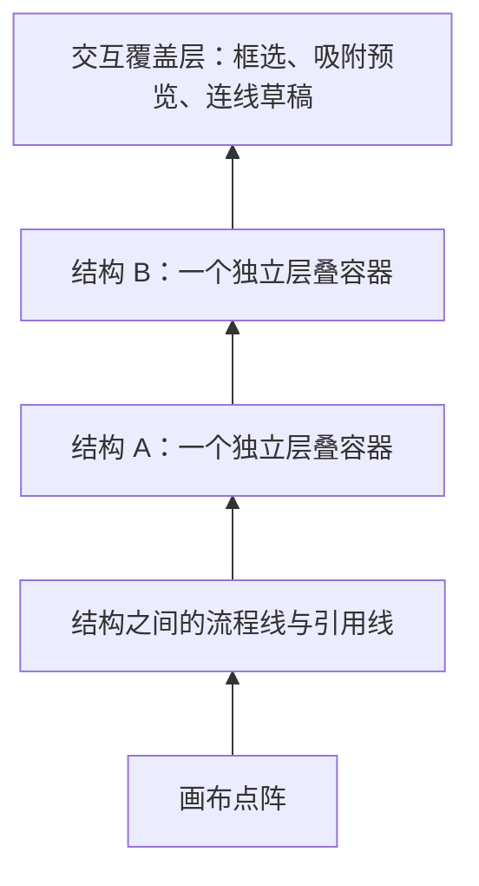

# 画布结构图层方案

状态：**已审核并实现**。日期：2026-10-30。

## 目标与现状

同一结构的节点、包络、附件和运算关系框共用一个对外层级。任何独立结构都只能整体位于另一结构上方或下方，不能出现 A 的节点在 B 上方、A 的运算符却在 B 下方的穿插。

当前画布按元素类型固定分层：包络、节点、关系框、流程线分别使用不同的全局 z-index；因此同一结构不是一个完整的遮挡单元。方案改为“结构容器排序 + 容器内部排序”，文档坐标、运算与执行顺序不受图层顺序影响。

## 1. 什么算同一结构

结构是以下关系反复合并后得到的集合：

- 数据运算与赋值连接的两端，包括整条表达式。
- 包络与其全部递归成员。一个最外层包络包含的所有节点始终属于同一结构，即使部分成员暂未相连。
- 附着循环、类型转换与其宿主包络。

**流程连接和引用连接不合并结构。** 它们表示结构之间的关系；例如 A → 条件分支 → B 仍可分别调整图层。把这些流程节点显式包进同一包络后，它们才共用一个图层。这个边界需要本次审核确认。

示例：`变量 ← 包络(常量 + 包络(常量 * 次数))` 是一个结构。该包络引用到的题目方法仍是另一个结构。

结构划分由图自动计算，不在图数据中增加需要手动维护的 groupId。使用节点 ID 的并查集/连通分量计算，并递归处理包络与附件；计算只依赖拓扑，单纯拖动不重复划分结构。

## 2. 渲染顺序

每个结构使用独立的 CSS stacking context，例如 `isolation: isolate`。只给结构容器分配全局 z-index，成员节点不再参与全局层级竞争。成员继续使用世界坐标，容器覆盖画布坐标系但不拦截空白处鼠标事件。

一个结构内部按以下顺序绘制：

1. 外层到内层的包络框与背景。
2. 两端都属于该结构的流程线、引用线。
3. 普通节点、数据关系框。
4. 包络标题、表达式结果、附件和流程端口。
5. 当前结构内的选中轮廓、转折点等操作柄。

内部排序仅决定成员之间的可读性，不允许成员突破其结构容器去盖住更高层的其他结构。嵌套包络只是结构内部的归属关系，不产生新的全局图层。

跨结构连线统一在所有结构下方绘制，连接锚点仍来自固定端口或节点边界；节点、端口优先响应点击。连线只在可见线段提供加宽命中区域。选中连线时，可将其高亮副本和编辑柄放到交互覆盖层，高亮线本身不截获端口点击。

## 3. 层级操作与手势

- 单击只改变选择，不永久改变图层，避免点击导致另一结构突然遮挡目标。
- 拖动时临时把所拖动结构显示在最上方；松手恢复原有层级，Esc 同时恢复位置与临时层级。
- 提供“上移一层 / 下移一层 / 置于顶层 / 置于底层”，作用于选中节点所属的完整结构；多选时保持各结构之间原有顺序。
- 当两个结构互相遮挡而无法点选下层时，通过图层列表选择。列表每行代表一个结构，显示包络名称；没有包络时显示赋值变量名或节点标题，并附节点数量。
- 只调整层级不改变节点坐标、连接、包络归属、表达式结果或流程执行次序。

## 4. 合并、拆分与保存

| 操作 | 层级规则 |
| --- | --- |
| 新建独立节点 | 放在最上层 |
| 建立数据连接、包络或附件关系 | 合并结构使用原结构中较高的层级，其余结构的相对顺序保持不变 |
| 删除数据边、解除包络或附件 | 新拆出的结构在原位置相邻排列，顺序按操作前的稳定成员顺序决定 |
| 建立或删除流程线、引用线 | 不改变结构层级 |
| 复制粘贴 | 粘贴结构放在最上层，保留被复制结构的相对顺序 |
| 撤销、重做 | 同时恢复结构拓扑、位置和层级 |
| 载入旧存档 | 使用原节点顺序生成确定的初始层级 |

建议在 CanvasDocument 增加可选的 `logicView.layerOrder: string[]`，按从下到上保存节点 ID 的稳定顺序。每个结构取其成员的最高序位作为整体序位；显式调整层级时把该结构的全部成员连续移动到目标序位。这个数组仅用于推导结构顺序，不向单个节点分配全局 z-index。

导入时去除失效和重复 ID，缺失的节点按图中顺序追加；Schema 校验数组长度与 ID 格式。保存仍使用现有外层文档格式，新字段可缺省；需同时更新保存、剪贴板、历史及解析逻辑。服务端执行忽略视图元数据。

## 5. 实现边界

新增纯函数模块 `logic-layers.ts`，负责结构划分、稳定排序、合并拆分后的顺序恢复和整组层级移动。渲染组件只消费结构列表与内部关系，不自行判断节点归属。

重构渲染为“跨结构连线 SVG + 多个结构容器 + 交互覆盖层”。每个结构容器拥有自己的内部连线 SVG、节点与关系框。现有几何、缩放、吸附和表达式求值函数继续复用。

实施顺序：先实现纯函数与存档兼容，再替换渲染与命中区域，然后加入图层列表和层级操作，最后完成真实浏览器回归。一次拖动/层级调整仍只产生一次可撤销操作。

## 6. 审核后验收标准

- 重叠的两条完整表达式整体遮挡，节点、运算符与包络标题不交错穿层。
- 三层以上嵌套包络、赋值目标及转换/循环附件同属一个全局层级。
- 引用和流程连接不意外合并独立结构；显式包络能将流程成员归为一层。
- 置顶、置底、多选、拆分、合并、复制粘贴后顺序稳定；撤销与重载还原同一画面。
- 25%～300% 缩放下，端口、关系框和可见连线的点击准确；拖动临时置顶与 Esc 恢复正确。
- 旧文档可载入，图层调整不改变编译输出或后端执行结果。

## 本次需确认的设计选择

1. 结构边界按数据连接、包络和附件划分；普通流程线、引用线不合并图层。
2. 单击保持层级，拖动仅临时置顶；永久层级由显式操作控制。
3. 提供按结构展示的图层列表，跨结构连线默认位于节点下方。
